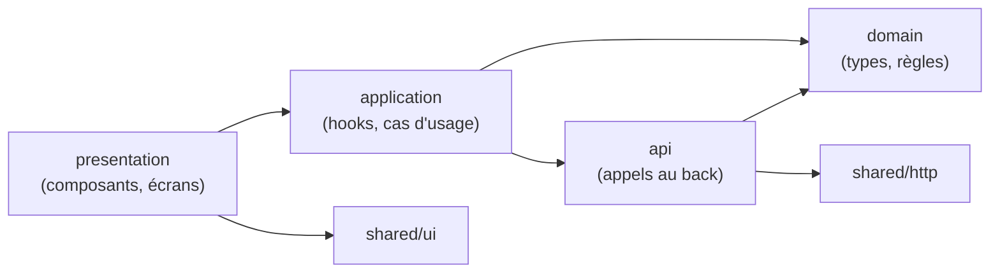

# Architecture du front-end Quizzard

Ce document décrit l'architecture du front-end de **Quizzard**, l'outil de quiz dynamique de l'IUT de Montreuil
(SAÉ 5.01A, BUT 3, 2026-2027). Il complète le dossier de conception et d'architecture technique de l'équipe et la
documentation du back-end (dépôt `DUT-Info-Montreuil/SAE_S5_2026_Quizzard_Back`, `docs/ARCHITECTURE.md`) ; en cas de
désaccord, le dossier de conception fait foi et ce fichier doit être mis à jour.

Documents liés : [DESIGN.md](DESIGN.md) (charte, écrans, conventions de code), [API.md](API.md) (consommation de
l'API du back).

Ce qui est **en place** est signalé comme tel ; le reste est la **cible** proposée par l'équipe. Les briques marquées
« à choisir » ne sont pas encore décidées : ne pas les présenter comme acquises.

---

## 1. Vue d'ensemble

Le front est une **application monopage** (SPA) React, responsive, servie en fichiers statiques sur le serveur de
l'IUT, derrière le même reverse proxy HTTPS que le back (`/api` et `/ws` sont relayés vers le back). Il sert trois
publics, sur trois supports :

| Public | Support | Écrans |
|---|---|---|
| Enseignant | Ordinateur | E1 Connexion, E2 Mes cours, E3 Éditeur cours + quiz, E4 Classements, E10 Résultats, E11 Correction |
| Salle (écran projeté) | Ordinateur de l'enseignant relié au vidéoprojecteur | E5 Quiz en cours, E6 Classement |
| Étudiant | Smartphone ou ordinateur personnel | E7 Rejoindre, E8 Question, E9 Résultat et classement |

Choix venant de l'étude de faisabilité (option 1, développement sur mesure) : front **React**, rendu du PDF dans le
navigateur avec **PDF.js**, temps réel par **WebSocket (STOMP)**, aucune dépendance externe à l'exécution.

Contraintes du cahier des charges qui pèsent sur le front :

- **Hébergement interne** : pas de CDN, de police ni d'image distante ; toutes les bibliothèques sont embarquées dans
  le build ; le QR code est généré par le back (`image/png`).
- **Temps réel** : réponses reçues affichées en moins de 1 s sur E5, classement à jour en moins de 2 s après la
  clôture ; jusqu'à 300 participants par séance.
- **Page étudiant chargée en moins de 3 s en Wi-Fi** et **sobriété** : bundle léger pour les écrans E7 à E9.
- **Ergonomie** : un étudiant rejoint un quiz en trois actions au plus.
- **Fiabilité** : reconnexion automatique d'un étudiant après une coupure réseau, reprise sur la question en cours.
- **Navigateurs** : versions récentes de Chrome, Firefox, Edge, Safari, sur ordinateur et smartphone (iOS, Android).

## 2. Pile technique

| Brique | État | Détail |
|---|---|---|
| React | En place | `react` et `react-dom` 19 |
| TypeScript | En place | 6.0, mode `bundler`, `noUnusedLocals`, `noUnusedParameters`, `verbatimModuleSyntax` |
| Vite | En place | 8, extension `@vitejs/plugin-react` ; serveur de développement sur le port 5173 |
| ESLint | En place | 10, `typescript-eslint`, `eslint-plugin-react-hooks`, `eslint-plugin-react-refresh` |
| Routeur | **À choisir** | Aucun installé (§4) |
| Gestion de l'état | Rien d'installé | Proposition : outils de React seuls, bibliothèque seulement si le besoin apparaît (§5) |
| Client HTTP | Rien d'installé | Proposition : `fetch` du navigateur, enveloppé dans `shared/http` (§6) |
| Client STOMP | **À choisir** | Aucun installé (§7) |
| PDF.js | **Retenu, pas installé** | Choix de l'étude de faisabilité (§8) |
| Tests | **À choisir** | Aucun outil installé |
| Image Docker du front | **À écrire** | Serveur de fichiers statiques à choisir (§11) |

## 3. Organisation du code

Le code est découpé **par fonctionnalité** (« feature »), avec les mêmes noms que les features du back, et chaque
feature suit les mêmes couches. L'arborescence ci-dessous est celle du dépôt (dossiers encore vides, `.gitkeep`).

```text
src/
├── app/
│   └── main.tsx            Point d'entrée ; à venir : routeur, fournisseurs de contexte, mise en page commune
├── features/
│   ├── compte/             E1 : connexion et déconnexion de l'enseignant, profil connecté
│   ├── cours/              E2, E3 (pages) : liste des cours, import, versions, pages insérées, aperçu PDF
│   ├── quiz/               E3 (questions) : quiz, questions, barème, déroulé, motifs
│   ├── seance/             E5, E7, E8, E9 : lancement, présentation projetée, parcours étudiant, temps réel
│   ├── classement/         E4, E6 : classements, podium projeté
│   ├── resultat/           E10, E11 : résultats d'une séance, correction des réponses libres, export CSV
│   └── administration/     Aucun écran défini par le cahier des charges pour l'instant
└── shared/
    ├── config/             Lecture de la configuration (import.meta.env)
    ├── http/               Client HTTP commun : session, CSRF, jeton de participant, erreurs
    ├── lib/                Utilitaires sans lien avec une feature (dates, heure du serveur…)
    └── ui/                 Composants communs de la charte (bouton, carte, champ, en-tête avec logo…)
```

`src/App.tsx`, `src/App.css`, `src/index.css` et `src/assets/` (image et logos React et Vite) viennent du modèle Vite
et seront remplacés par les écrans et la feuille de style de la charte.

Chaque feature suit la même structure :

```text
features/<feature>/
├── domain/         Types métier et règles pures : temps restant, question complète, ordre des pages…
│                   Aucune dépendance à React, au réseau ou au navigateur.
├── api/            Appels au back pour cette feature, via shared/http ; conversion DTO ↔ types du domaine
├── application/    Hooks et cas d'usage (useMesCours, useSeanceEnDirect) : orchestrent api et domain,
│                   gèrent chargement, erreurs et état local
└── presentation/   Composants React et écrans ; n'appellent pas le réseau directement
```

### Règle de dépendance



- Le **domaine** ne dépend de rien d'autre que de TypeScript et de `shared/lib`.
- La **présentation** n'appelle jamais `fetch` ni STOMP : elle passe par un hook de la couche application.
- Une feature n'importe **jamais** le code interne d'une autre feature. Ce qui est commun va dans `shared` ;
  l'assemblage (routes, mise en page) se fait dans `app`.

## 4. Routage des écrans E1 à E11

Le routeur n'est pas encore choisi. Les chemins ci-dessous sont une **proposition** de l'équipe, à confirmer au
premier ticket qui installe le routeur ; une fois fixés, ils sont reportés ici et dans [DESIGN.md](DESIGN.md).

| Chemin proposé | Écran | Accès | Remarque |
|---|---|---|---|
| `/connexion` | E1 Connexion | Public | Redirige vers `/cours` si déjà connecté |
| `/cours` | E2 Mes cours | Enseignant | Page d'accueil de l'enseignant |
| `/cours/:idCours` | E3 Éditeur cours + quiz | Enseignant | Ouvre la dernière version ; sélection de page dans l'URL ou l'état, à choisir |
| `/classements` | E4 Classements | Enseignant | |
| `/seances/:idSession` | E5 Quiz en cours, E6 Classement | Enseignant | Présentation projetée : pages du cours, page de quiz (E5), page de classement (E6) |
| `/rejoindre/:codeAcces` | E7 Rejoindre | Public | Cible du lien et du QR code |
| `/rejoindre/:codeAcces/question` | E8 Question, E9 Résultat | Étudiant (jeton) | E8 et E9 alternent selon les messages temps réel (E9-4) |
| `/cours/:idCours/resultats` | E10 Résultats de la séance | Enseignant | Liste des séances du cours, détail de la séance choisie |
| `/seances/:idSession/questions/:idQuestion/correction` | E11 Correction | Enseignant | Ouvert depuis E10 |

Règles :

- **Garde enseignant** : au chargement d'un écran enseignant, le front appelle `GET /api/auth/moi` ; un `401`
  renvoie vers `/connexion`, puis vers l'écran demandé après la connexion.
- **Garde étudiant** : sans jeton de participant pour ce `codeAcces`, `/rejoindre/:codeAcces/question` renvoie vers
  E7.
- **Lien de séance** : le back renvoie `lien` au lancement (`POST /api/quiz/{idQuiz}/sessions`). Ce lien doit pointer
  vers la route de E7 : le format est à aligner avec l'équipe back.
- **Liens profonds** : le serveur de fichiers statiques doit renvoyer `index.html` pour tout chemin qui n'est pas un
  fichier, sinon un QR code scanné aboutit à une erreur 404.
- **Découpage du bundle** : les écrans étudiants (E7 à E9) ne doivent pas charger le code de l'éditeur ni PDF.js
  quand le mode d'affichage ne l'exige pas (chargement différé par route, `import()` dynamique de Vite).

## 5. Gestion de l'état

Proposition, sans bibliothèque tant que le besoin ne se présente pas :

| État | Où | Comment |
|---|---|---|
| Données du serveur (cours, quiz, classements, résultats) | Hook de la couche `application` de la feature | Chargement à l'ouverture de l'écran, rechargement après une action ; états chargement, erreur, vide |
| Enseignant connecté | Contexte React fourni dans `app` | Rempli par `GET /api/auth/moi`, vidé à la déconnexion ou sur un `401` |
| Participant (jeton, pseudonyme) | Feature `seance` | Conservé par `codeAcces` pour survivre à un rechargement de la page ; emplacement proposé : `sessionStorage` (à valider) |
| Séance en direct (question, échéance, répartition, classement) | Feature `seance` | Réducteur (`useReducer`) alimenté par les messages STOMP et par les resynchronisations REST |
| Formulaire de l'éditeur (E3) | Composant de l'écran | Alerte en cas de modifications non enregistrées (E3-10) |

Si un cache partagé entre écrans ou une invalidation fine devient nécessaire, le choix d'une bibliothèque se fait
en équipe et est reporté ici.

## 6. Client REST

Un seul client, dans `src/shared/http`, construit sur `fetch`. Toutes les features passent par lui.

- **Adresse** : `VITE_API_URL` (§10) + chemin du back (`/api/...`, `/api/public/...`).
- **Cookies** : `credentials: "include"` sur toutes les requêtes, pour la session de l'enseignant.
- **CSRF** : sur `POST`, `PUT`, `PATCH`, `DELETE`, en-tête `X-XSRF-TOKEN` avec le jeton obtenu par
  `GET /api/auth/csrf` (détail dans [API.md](API.md)).
- **Étudiant** : en-tête `X-Jeton-Participant` sur les routes `/api/public/**` qui l'exigent.
- **JSON** par défaut ; `multipart/form-data` pour l'import d'un PDF (ne pas fixer `Content-Type`, le navigateur ajoute
  la frontière) ; réponse binaire pour le PDF, le QR code et l'export CSV.
- **Erreurs** : toute réponse non 2xx est convertie en une erreur typée qui garde `status`, `error`, `request_id` et,
  pour un `422`, `champs`. Les écrans affichent `error` et, pour un incident, le `request_id` à transmettre à
  l'équipe. Comportement par statut : [API.md](API.md).
- **Heure du serveur** : le client relève l'écart entre l'en-tête `Date` des réponses et l'horloge de l'appareil,
  utilisé pour le décompte (§7).
- Les types des DTO vivent dans la couche `api` de chaque feature, avec les noms JSON du back.

## 7. Client STOMP et reconnexion

Le serveur **pousse** l'état de la séance ; le front **n'envoie aucune commande par STOMP** (commandes en REST).

- Connexion : `/ws` sur la même origine que l'API (`wss://` en production), protocole STOMP. La bibliothèque cliente
  est **à choisir** ; critères : WebSocket natif, reconnexion automatique, battements de cœur (heartbeats),
  en-têtes personnalisés dans la trame `CONNECT`, taille raisonnable du bundle.
- Authentification : cookie de session pour l'enseignant ; en-tête STOMP `X-Jeton-Participant` dans la trame
  `CONNECT` pour l'étudiant.
- Abonnements par écran (destinations du back, [API.md](API.md)) :
  - E5 (enseignant) : `etat`, `question`, `connectes`, `repartition`, `correction`, `ecran`, `classement` sous
    `/topic/sessions/{codeAcces}/` ;
  - E8, E9 (étudiant) : `etat`, `question`, `correction` sous `/topic/sessions/{codeAcces}/`, et
    `/user/queue/resultat`.
- Un seul client STOMP par onglet, ouvert à l'entrée dans la séance et fermé à la sortie ou à la clôture.

### Reconnexion

Le broker du back est en mémoire et ne rejoue pas les messages manqués. Après une coupure :

1. le client STOMP retente la connexion avec un délai croissant et borné ;
2. une fois reconnecté, il se réabonne aux mêmes destinations ;
3. le front **resynchronise l'état par REST** : `POST /api/public/sessions/{codeAcces}/reconnexion` pour l'étudiant
   (état courant et score), `GET /api/sessions/{idSession}` pour l'enseignant ;
4. pendant la coupure, un bandeau indique la perte de connexion ; une réponse déjà confirmée reste affichée comme
   confirmée.

Un rechargement de la page suit le même chemin : le jeton de participant conservé (§5) permet d'appeler
`reconnexion`.

### Décompte

Le temps restant = `echeance` (envoyée par le serveur) − heure du serveur estimée (horloge de l'appareil + écart
mesuré au §6). Le bouton Valider se désactive à 0 (E8-1), mais c'est le serveur qui refuse une réponse hors délai
(`409`). Points à régler avec le back : [API.md](API.md) §8.

## 8. Rendu du PDF avec PDF.js

Retenu par l'étude de faisabilité (licence Apache 2.0), **pas encore installé**.

- Le PDF n'est jamais servi en accès direct : PDF.js le charge par la route protégée
  `GET /api/cours/{idCours}/versions/{idVersion}/fichier`, avec le cookie de session (enseignant) ou l'en-tête
  `X-Jeton-Participant` (étudiant, si le mode d'affichage l'exige).
- **Tout est embarqué** : le worker de PDF.js et ses ressources annexes (polices standard, tables de caractères)
  sont copiés dans le build et servis par l'application ; aucune adresse de CDN.
- Usages :
  - E3 : miniatures des pages du cours et aperçu de la page sélectionnée ;
  - présentation projetée (`/seances/:idSession`) : page courante en grand, pages de quiz (E5) et de classement (E6)
    intercalées selon l'ordre des pages insérées ;
  - écrans étudiants : seulement si le mode « pages du cours aussi sur l'appareil des étudiants » est retenu
    (**point ouvert** du cahier des charges, §2.7 point 8).
- Les pages de quiz et de classement ne sont pas dans le PDF : ce sont des composants React placés entre deux pages,
  à partir de `GET /api/cours/{idCours}/versions/{idVersion}/pages`.
- Performance : rendu des miniatures à la demande (pages visibles seulement), une instance du document par écran.
- Solution de repli en séance (cahier des charges §4.8) : le PDF d'origine reste téléchargeable et projetable sans
  quiz.

## 9. Sécurité côté navigateur

| Sujet | Décision |
|---|---|
| Session enseignant | Cookie `HttpOnly` posé par le back : le front ne le lit pas et ne stocke aucun mot de passe ni jeton de session. |
| CSRF | En-tête `X-XSRF-TOKEN` sur toute requête qui modifie des données. |
| Jeton de participant | Valable pour une seule séance, invalidé à la clôture ; conservé seulement le temps de la séance, supprimé à la clôture. |
| Injection | Rendu par React (échappement par défaut) ; pas de `dangerouslySetInnerHTML` pour un contenu saisi (énoncé, proposition, pseudonyme, réponse libre). |
| Confidentialité | Écrans projetés : pseudonyme et score uniquement. L'identité d'un étudiant (quiz noté) n'apparaît que sur E10 et dans l'export, pour l'enseignant propriétaire. |
| Réponses attendues | Le front ne les reçoit pas avant la clôture (garantie par le back) ; il ne les déduit ni ne les met en cache côté étudiant. |
| Journalisation | Aucune donnée personnelle (nom, pseudonyme, identifiant, texte de réponse) dans la console du navigateur. |
| Ressources externes | Aucune : pas de CDN, police, image ou script tiers. Une politique de sécurité du contenu (CSP) limitée à la même origine est à définir au reverse proxy. |
| Liens | `rel="noopener noreferrer"` sur tout lien qui ouvre un nouvel onglet. |
| Messages d'erreur | Message générique pour un échec de connexion (E1-4, E7-4), sans préciser le champ erroné. |
| Information RGPD | Mention d'information sur E1, E7 (E7-5) et à la connexion LDAP d'un étudiant : finalité, base légale, durée de conservation, contact ; textes à valider avec le délégué à la protection des données. |

## 10. Configuration

Vite lit `.env` (non commité) ; seules les variables préfixées par `VITE_` sont visibles dans le code, par
`import.meta.env`, et elles sont **recopiées dans le JavaScript envoyé au navigateur** : elles sont publiques.

| Variable | Défaut (`.env.example`) | Usage |
|---|---|---|
| `VITE_API_URL` | `http://localhost:8080` | Adresse du back ; aussi base de l'adresse `/ws` |

- La lecture se fait à un seul endroit (`src/shared/config`) ; le reste du code n'utilise pas `import.meta.env`.
- En développement, le front (`http://localhost:5173`) et le back (`http://localhost:8080`) ont des origines
  différentes : le back autorise l'origine `FRONT_URL` par CORS, cookies compris.
- En production, front et back sont derrière le même reverse proxy : même origine, pas de CORS. La valeur de
  `VITE_API_URL` pour la production (vide pour un chemin relatif, ou adresse complète) est **à fixer** avec le
  déploiement. Comme Vite l'inscrit au moment du build, l'image du front est construite pour une adresse donnée.

## 11. Build et déploiement

- `npm run build` : `tsc -b` (vérification des types) puis `vite build` ; résultat statique dans `dist/`.
- Cible (cohérente avec le back) : une image Docker du front qui sert `dist/` en statique, dans le Docker Compose de
  production, derrière le reverse proxy HTTPS de l'IUT (WebSocket compris). Le Dockerfile et le serveur de fichiers
  statiques sont **à choisir et à écrire**.
- Le serveur statique doit : renvoyer `index.html` pour les routes de la SPA (§4) ; mettre en cache longtemps les
  fichiers à empreinte de `dist/assets/` et ne pas mettre en cache `index.html`.
- Mise à jour hors des plages de cours (8 h – 20 h en semaine) pour ne pas couper une séance.
- Guide d'installation commun rédigé en anglais (livrable du Sprint 4).
- Chaîne d'intégration continue (lint, build, tests) : à mettre en place par le Dev/Ops – Dev qualité.

## 12. Décisions et points ouverts

| # | Décision ou point | État |
|---|---|---|
| F1 | React + TypeScript + Vite | En place |
| F2 | Découpage par feature, mêmes noms que le back ; couches `api`, `application`, `domain`, `presentation` | En place (dossiers) |
| F3 | Commandes en REST, diffusion en STOMP, resynchronisation REST après reconnexion | Retenu (aligné sur le back) |
| F4 | Décompte calé sur l'échéance et l'heure du serveur | Retenu |
| F5 | PDF.js embarqué, PDF chargé par route protégée | Retenu, à installer |
| F6 | Routeur, client STOMP, outil de test | À choisir |
| F7 | Chemins des écrans (§4) et format du `lien` de séance | Proposition, à confirmer avec le back |
| F8 | Mode d'affichage du cours sur les appareils étudiants | Point ouvert du cahier des charges, à redemander au client |
